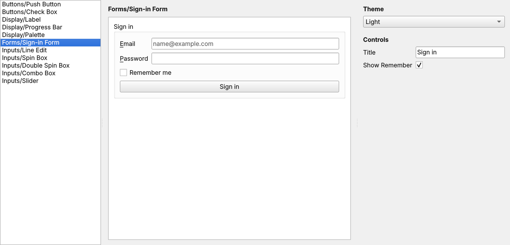

# pyside6-storybook

A small, Storybook-style component explorer for [PySide6](https://doc.qt.io/qtforpython-6/). Write *stories*, functions that
build one widget in one state, and browse them in a gallery window: edit each story's arguments live, switch between light and
dark themes, and see an error in place of a story that breaks instead of a crashed app.



> **Status:** early development, not yet released. The first release, 0.1.0, will be published on PyPI; until then, install it
> from GitHub as shown below. [`docs/roadmap.md`](docs/roadmap.md) describes what is planned next.

## Install

pyside6-storybook needs Python 3.11 or newer and PySide6 6.8 or newer. Its only dependency is `PySide6-Essentials`, which a
project that already depends on the full `PySide6` package satisfies.

```bash
pip install git+https://github.com/Youth-Research-Center/pyside6-storybook
```

or, as a development dependency of a project managed with [uv](https://docs.astral.sh/uv/):

```bash
uv add --dev git+https://github.com/Youth-Research-Center/pyside6-storybook
```

uv installs it into the project's `.venv` without activating that environment, so with uv, put `uv run` in front of the
`pyside6-storybook` commands in this README (or activate `.venv` first).

Then open the built-in example stories:

```bash
pyside6-storybook --examples
```

With uv:

```bash
uv run pyside6-storybook --examples
```

## Your first story

Create `stories/greeting_story.py` in your project:

```python
from PySide6.QtWidgets import QPushButton, QWidget

from pyside6_storybook import BoolControl, StoryContext, TextControl, story


@story(
    "Buttons/Greeting",
    controls=[TextControl("text", "Hello!"), BoolControl("enabled", default=True)],
)
def greeting_button(ctx: StoryContext) -> QWidget:
    """A push button whose text and enabled state can be edited in the gallery."""
    button = QPushButton(ctx.args["text"])
    button.setEnabled(ctx.args["enabled"])
    return button
```

and open it, with `uv run` in front when you installed with uv:

```bash
pyside6-storybook stories
```

- `@story` registers the function under an id. The parts before the last `/` group stories (here `Buttons`); the last part is the
  story's name.
- The gallery calls the function with a `StoryContext`: `ctx.args` holds the current value of each control, by name, and
  `ctx.theme` the name of the active theme. The story is built again from scratch whenever a control or the theme changes.
- The function returns the widget to show. If it raises, or returns something that is not a widget, the gallery shows the error
  and its traceback in place of the widget, and the other stories keep working.
- Discovery picks up every file named `*_story.py` or `*_stories.py` below a folder. Story files can import your application, and
  each other, like any module of your project.

## Variants

A variant is the same story with other starting values: it shares the story's function and controls, and shows up in the gallery as a
story of its own. Call `.variant()` on the story that `@story` returned:

```python
from PySide6.QtWidgets import QPushButton, QWidget

from pyside6_storybook import BoolControl, StoryContext, TextControl, story


@story(
    "Inputs/Push Button/Default",
    controls=[TextControl("text", "Click me"), BoolControl("enabled", default=True)],
)
def push_button(ctx: StoryContext) -> QWidget:
    """A push button."""
    button = QPushButton(ctx.args["text"])
    button.setEnabled(ctx.args["enabled"])
    return button


push_button.variant("Disabled", args={"enabled": False})
push_button.variant("Long label", args={"text": "A button with a much longer label"})
```

- The variant's id is the story's component, which is its id without the last segment, plus the variant's name:
  `Inputs/Push Button/Disabled`. Give a story that will have variants an id whose last segment names the story, such as
  `"Inputs/Spin Box/Default"`; with `"Inputs/Spin Box"` the component would be `Inputs` and the variant `Inputs/Large`.
- `args` replaces the defaults of some controls, by control name. Each value must be one its control accepts, and each key must be
  a control of the story; otherwise `.variant()` raises a `ValueError` naming the variant and the key. The controls stay editable.
- The name must not be blank, contain `/` or equal the story's own name. Call `.variant()` on the base story, not on a variant, and
  only after `@story` registered it. A story whose id has no group (`"Button"`) cannot have variants.
- Variants appear after their story, in the order you create them. Creating the same variant twice replaces the first one.

## Layout and decorators

The preview places your widget in one of three ways. Pick one per story with `layout=`, a `Layout` member or its string value:

```python
from PySide6.QtWidgets import QPlainTextEdit, QPushButton, QWidget

from pyside6_storybook import Layout, StoryContext, story


@story("Buttons/Centered/Default", layout=Layout.CENTERED)
def centered_button(ctx: StoryContext) -> QWidget:
    """A push button at its natural size, in the middle of the preview."""
    return QPushButton("Centred")


centered_button.variant("Padded", layout=Layout.PADDED)


@story("Editors/Notes", layout="fill")
def notes(ctx: StoryContext) -> QWidget:
    """A text editor that fills the preview."""
    return QPlainTextEdit("Fills the preview")
```

- `Layout.PADDED` (the default) puts the widget at the top of the preview, inside a margin. Its width follows its size policy, so a
  push button stretches across the preview, and its height is its natural height.
- `Layout.CENTERED` gives the widget its natural size and centres it, horizontally and vertically.
- `Layout.FILL` gives the widget the whole preview inside the margin, in each direction its size policy lets it grow. In a direction
  it cannot grow (a push button is vertically fixed) it keeps its natural size and is centred. It shrinks with the window and the
  preview shows no scroll bars.
- In `PADDED` and `CENTERED` a widget larger than the preview scrolls instead of being squeezed. The natural size is the widget's
  `sizeHint()`, raised to its minimum size and capped by its maximum size. A word-wrapped `QLabel` wraps in a narrow preview instead.
- A variant has its story's layout unless you give it another with `layout=`. `layout=None` is the same as leaving it out.
- To change the layout of every story that declares none, set `default_layout` on the registry, for example
  `default_registry.default_layout = Layout.CENTERED`. An invalid layout, in `layout=` or in `default_layout`, raises a `ValueError`.
- The error shown for a story that fails, and the "Load errors" view, always fill the preview.

### Decorators

A decorator wraps the widget your story builds, to add padding, a border or a fixed size without changing the story. It is a function
that receives the widget built so far and the `StoryContext`, and returns the widget to show. Pass a list with `decorators=`:

```python
from PySide6.QtWidgets import QGroupBox, QLabel, QVBoxLayout, QWidget

from pyside6_storybook import StoryContext, story
from pyside6_storybook.decorators import fixed_size, frame, padding


def in_group_box(widget: QWidget, ctx: StoryContext) -> QWidget:
    """Show the widget inside a group box titled with the active theme."""
    box = QGroupBox(ctx.theme)
    QVBoxLayout(box).addWidget(widget)
    return box


@story("Cards/Card/Default", decorators=[padding(24), fixed_size(320, 200)])
def card(ctx: StoryContext) -> QWidget:
    """A 320 by 200 label inside 24 pixels of padding."""
    return QLabel("Card")


card.variant("Framed", decorators=[frame(), in_group_box])
```

- The built-ins are in `pyside6_storybook.decorators`: `padding(horizontal, vertical=None)` adds transparent space (`vertical` defaults to
  `horizontal`), `frame()` draws a panel border from the palette, and `fixed_size(width, height)` calls `setFixedSize` on the widget and
  adds no wrapper. Sizes and padding must be ints; padding must not be negative and sizes must be positive.
- The first decorator in a list is the outermost, like stacked Python `@decorators`: the last one is applied first, next to your widget. So
  `decorators=[padding(24), fixed_size(320, 200)]` is a 320 by 200 widget inside 24 pixels of padding.
- `StoryRegistry.decorators` is a plain list of decorators for every story of that registry, for example
  `default_registry.decorators.append(padding(8))` in your stories package's `__init__.py`. They wrap the story's own decorators, the first
  one outermost, and the list is read each time the preview is built.
- A variant has its story's decorators unless it gives a list with `decorators=`, which replaces them (an empty list removes them).
  Registry decorators always apply.
- To write one, return the widget you received after configuring it, or a new widget that contains it as a descendant: put it in a layout
  of the wrapper, as `in_group_box` does. A decorator that raises, returns something that is not a `QWidget`, or returns a widget that
  does not contain the widget it received (with the story's widget inside), shows an error in the preview that names the decorator.
- Decorators run on every rebuild, so keep them stateless, like stories. The `Decorator` type is exported for annotations.

## Controls

Each control is an argument of the story and an editor in the gallery's controls pane.

| Control | Editor | Value in `ctx.args` |
| --- | --- | --- |
| `TextControl(name, default, *, multiline=False)` | line edit, or a multi-line text edit | `str` |
| `BoolControl(name, default=...)` | check box | `bool` |
| `ChoiceControl(name, default, options)` | combo box | `str`, one of `options` |
| `IntControl(name, default, minimum, maximum, *, step=1, slider=False)` | spin box (32-bit range), optionally with a slider | `int` |
| `FloatControl(name, default, minimum, maximum, *, step=None, decimals=None, slider=False)` | spin box with decimals, optionally with a slider | `float` |
| `ColorControl(name, default, *, alpha=False)` | swatch button that opens a colour dialog, and a hex field | `QColor` |
| `EnumControl(name, default)` | combo box of the member names | the enum member |
| `FileControl(name, default="", *, filter="")` | path field and a "Browse…" button | `pathlib.Path`, or `None` while empty |

Every control also takes two keyword-only fields:

- `label`: the text of the form label. Without it the label is derived from `name`: `tile_type` becomes "Tile Type".
- `description`: a sentence shown as the tooltip of the label and the editor, and read out by screen readers as the editor's description.

```python
IntControl("columns", 3, 1, 12, label="Number of columns", description="How many columns the grid has.", slider=True)
```

The options:

- `TextControl(multiline=True)` edits the text in a multi-line editor; Tab moves focus on instead of inserting a tab.
- `IntControl(step=...)` is the spin box's single step (arrow keys), at least 1. With `slider=True` a slider sits beside the spin box and
  moves by the same step.
- `FloatControl(step=...)` is the spin box's single step, greater than 0 and at most the range. Without it, the step is a power of ten
  near 1% of the range. `decimals` (0 to 10) is how many decimals the editor shows; without it, the fewest that show the step, the
  default and both bounds exactly, at least 2. With `slider=True`, the slider has one position per step, and its last position is
  always `maximum`, even when the step does not divide the range. A slider may have at most 10 000 steps; use a larger `step` for a
  wider range.
- `ColorControl` takes a hex string as its default: `"#RRGGBB"`, in either case. With `alpha=True` it also takes `"#RRGGBBAA"` (the CSS
  byte order, opacity last), and the dialog shows an alpha channel. Colour names and `"#RGB"` are not accepted. The story receives a
  new `QColor` on every render. In the hex field, an invalid entry reverts to the current colour.
- `EnumControl` takes a member of any Python or Qt enum as its default, which also fixes the enum class. The editor offers the named
  members in definition order; an alias is left out and the first name kept. For a flag enum, named combinations such as
  `Qt.AlignmentFlag.AlignCenter` are options, but an unnamed combination such as `AlignLeft | AlignTop` is not. `control.options` lists
  them.
- `FileControl(filter=...)` is a `QFileDialog` name filter such as `"Images (*.png *.jpg)"`. The file need not exist, and a relative path
  stays relative to the working directory.

A control checks its own values. A default must have the control's type: a `bool` is not accepted for an `IntControl` or a
`FloatControl`, an `int` is not accepted for a `BoolControl`, and a `ColorControl`'s default is a hex string, not a `QColor`. A
`FloatControl` rejects a default or bound that needs more than 10 decimals, and one that needs more decimals than `decimals` allows,
because the editor would silently round it.

In the gallery, a spin box, slider or combo box reacts to the mouse wheel only while it has keyboard focus, so scrolling the controls
pane never changes a value by accident. Click a control or press Tab to focus it. The controls pane scrolls when a story has more
controls than fit.

A story without controls is fine; the controls pane then says so. The [example stories](src/pyside6_storybook/examples) use every
control type and option.

## Where your stories come from

`pyside6-storybook path/to/stories` loads the folders, `.py` files and dotted module names you give it; `--examples` adds the
built-in example stories. Run without targets, it looks in this order:

1. **`pyproject.toml`** in the current directory:

   ```toml
   [tool.pyside6-storybook]
   stories = ["stories"]   # folders, .py files or dotted module names, relative to this file
   pythonpath = ["src"]    # optional: folders put on sys.path first, so stories can import your application
   ```

2. **Entry points** of installed packages, each naming a module of stories:

   ```toml
   [project.entry-points."pyside6_storybook.stories"]
   my_widgets = "my_widgets.stories"
   ```

3. **The built-in examples**, only when neither of the above is configured. A configured source that fails to load is reported
   as an error; it never falls back to the examples.

A story module that fails to import is listed in the gallery under "Load errors" with its traceback, and the gallery opens with
the stories that did load.

## Command line

```text
pyside6-storybook [TARGET ...]        open the gallery with the stories in these folders, files or modules
  --examples                          also load the built-in example stories
  --theme {Light,Dark}                the theme to start in
  --list                              print the story ids and exit, without a window (works without a display)
  --no-reload                         do not load the stories again when a file changes (see "Hot reload")
  --version                           print the version
```

`python -m pyside6_storybook` takes the same arguments. With `--list`, standard error also says which source the stories came
from, and the exit code is 1 if any story module failed to load.

## The gallery window

The window has three panes: the story list on the left, the preview of the selected story in the middle, and the theme switch and
the story's controls on the right. The middle pane has two tabs: "Canvas", the rendered story, and "Docs", described below. The right
pane has two as well: "Controls" and "Actions", described under "Logging actions".

The story list is a tree built from the story ids. Each `/`-separated segment but the last is a branch, and the stories are leaves,
in the order they were registered. A component below the top level that has only one story, such as
`Forms/Sign-in Form/Default`, is shown as that story's row. When both `A/B` and `A/B/C` are stories, `B` is a story row with `C`
listed under it. Source files that failed to load are listed in a "Load errors (N)" row at the end.

Selecting a story, with the mouse or the Up and Down keys, opens it at once. The search field above the tree keeps the stories whose
id contains what you type, ignoring case, together with the branches they are in, which it expands. Typing never changes the story in
the preview: a selected story that the search hides stays in the preview, and is shown selected again when it matches. Clearing the
search brings back the branches you had expanded or collapsed.

### Keyboard

The whole window works from the keyboard. Tab visits the search field, the story tree, the preview tabs, the canvas controls, the
preview, then the theme switch, the side pane tabs and the controls; Shift+Tab goes back. Every control has an accessible name, and
the preview area is named "Preview of" followed by the story id. Choose "Keyboard shortcuts" in the Help menu, or press `F1`, to see
this list in the window.

| Keys | Action |
| --- | --- |
| `Ctrl+F` or `/` | Focus the search field and select its text. `/` types a slash while a text field, spin box or editable combo box has focus. |
| `Ctrl+Alt+Down` and `Ctrl+Alt+Up` | Open the next or previous story in the list. Stories the search hides are skipped, and the branch of the story is expanded. |
| `Ctrl+T` | Switch to the next theme. |
| `F6` and `Shift+F6` | Move focus to the next or previous pane (story list, preview, side pane), at the widget that had focus there last. |
| `Ctrl++` (or `Ctrl+=`), `Ctrl+-` and `Ctrl+0` | Zoom in, zoom out and reset the zoom, while focus is in the preview pane. |
| `F1` | Show the keyboard shortcuts. |
| Down in the search field | Select the first story the search keeps. |
| Enter in the search field | Open the first story the search keeps. |
| Escape in the search field | Clear the search; when it is empty, move focus to the tree. |
| Escape in the tree | Clear the search. |
| Left and Right in the tree | Collapse and expand a branch. |

`Alt+Down` is not a window shortcut: it opens a combo box's popup, as it does in any Qt application. Rebuilding the preview, after a
control edit or a theme switch, never takes focus from the control you are using. If the focus was inside the story's own widget, it
moves to the preview area instead.

### The canvas

Above the preview, two menus and the zoom buttons change how a story is shown. None of them changes the story: it is built the same way
and receives the same arguments.

- **Background** is what the story sits on: "Window" (the default), "Base" or "Alternate Base" (a colour of the active theme, which a
  theme switch keeps up to date) or "Checkerboard" (8-pixel squares of the theme's Base and Mid colours, to judge transparency).
- **Size** is "Fit" (the default: the story is placed in the whole preview, as the story's `layout` says), one of the built-in sizes
  "Phone portrait" (320 × 480), "Phone landscape" (480 × 320) and "Dialog" (800 × 600), your own sizes (below), or "Custom…", which
  shows a Width and a Height field. With a size selected, the area the story is placed in is exactly that many pixels, so a `FILL`
  story is exactly that size and a `CENTERED` story is centred in it. The area is outlined, centred in the preview, and the preview
  scrolls when the window is smaller. The label at the right shows the size.

- **Zoom** shows the preview at 50, 67, 100, 150, 200, 300 or 400%. The buttons below the menus step to the previous or next level
  and reset to 100%; `Ctrl++` (or `Ctrl+=`), `Ctrl+-` and `Ctrl+0` do the same while focus is in the preview pane, and `Ctrl` with the
  mouse wheel, also over the story's own widgets, zooms one level per notch. Zooming keeps the centre of the visible area in place; with the wheel, the point under
  the cursor stays under it. At 100% the live widget is shown. At any other level the canvas shows an image of the
  preview scaled without smoothing, so 400% turns a one-pixel line into four sharp pixels. A zoomed preview is not interactive: return
  to 100% to click, type or open popups. The image is taken again when a control, the theme, the background or the size changes. A level
whose image would have more than 64 million device pixels is skipped for a large size.

The choices stay while you switch stories, switch themes or reload; they are not saved between runs.

To list sizes of your own, such as the screens your application supports, append `SizePreset` objects (a name, a width and a height in
pixels, each from 1 to 10 000) to `size_presets` of the registry. They follow the built-in sizes in the Size menu:

```python
from pyside6_storybook import SizePreset, default_registry

default_registry.size_presets.append(SizePreset("Tablet", 768, 1024))
default_registry.size_presets.append(SizePreset("Small laptop", 1280, 720))
```

### The Docs tab

The Docs tab describes the selected story, top to bottom:

- the docstring of the module the story is defined in, and the story function's docstring (a heading appears only for a docstring
  that exists);
- a table of the story's controls with each control's type, its starting value and its range or options (a variant shows its own
  starting values), or "No controls.";
- for a story with variants, the list "Stories of <component>": the base story and its variants, each one a link that opens that
  story, and the current one as plain text;
- the source code of the story function in a read-only view, with a "Copy" button that puts it on the clipboard. A story whose source
  cannot be read, such as one built from a `functools.partial`, shows "Source not available for this story." instead.

The tab updates when you select another story, not when you change a control.

## Logging actions

The Actions tab lists what a story reports, newest first, with the time, the action and its arguments. A story opts in signal by
signal with `ctx.log_signal`, or logs anything with `ctx.log`:

```python
from PySide6.QtWidgets import QPushButton, QWidget

from pyside6_storybook import StoryContext, story


@story("Buttons/Counter")
def counter(ctx: StoryContext) -> QWidget:
    """A button that logs its signals."""
    button = QPushButton("Click me")
    ctx.log_signal(button.clicked)
    ctx.log_signal(button.toggled, name="toggle")
    button.clicked.connect(lambda: ctx.log("custom", "any", 1))
    return button
```

`log_signal` shows the arguments the signal delivers to a slot, so `QPushButton.clicked` reads `clicked()` and a slider's
`valueChanged` reads `valueChanged(5)`. The signal's own name is used unless you pass `name=`. Arguments are shortened to 200
characters, and the panel keeps the last 500 actions. Clear empties it, and so does selecting another story; changing a control or the
theme builds the story again and keeps the log. Under a plain `StoryContext`, such as a test builds, `log_signal` and `log` do nothing,
so the story needs no check. `StoryContext.actions` is the `ActionSink` that receives the actions.

## Hot reload

The gallery loads your stories again when you save a file, so an edit shows in the preview without a restart. It watches the story
files you named (and every folder below a folder target, so a new story file is noticed), the modules those stories import from your
project, and the story modules of a package or entry point. A change is acted on 300 ms after the last write, and one burst of saves
reloads once. The status bar shows "Reloaded 14:02:11", or "Reload failed 14:02:11: 1 story source failed to load".

A reload drops from `sys.modules` the story modules and their parent packages, and every other module whose file is below the working
directory or a `pythonpath` folder from `pyproject.toml` (not one in `site-packages`, `.venv`, `venv`, `node_modules` or a hidden folder),
then loads the targets again into a new registry. Everything your project owns runs again in import order, so an edited widget class is
picked up like an edited story, and a package `__init__` that appends to `default_registry.decorators` or `size_presets` ends up with
one entry, not two.

- **A good reload** replaces the story list. The selected story stays selected, and each control keeps its value when the new control of
  the same name accepts it; an enum control keeps the member of the same name in the reloaded enum class. If the story is gone, the story
  now at its position in the list is selected, or the last one. The Actions log stays for the same story, and the theme and the
  canvas settings do not change.
- **A failed reload** changes nothing: the previous stories stay, the preview shows the errors, and the status bar says so until the next
  good reload. A reload fails when it finds no story, or when a source fails that was not already failing. Changing a control or the
  theme meanwhile shows the last good story again. Fixing the file, including a story file that never imported, reloads it.

Limits: modules installed in `site-packages` are not reloaded unless they are story modules, state kept outside the project (a database
connection, a registry in a library) survives a reload, and a story file's own side effects at import time run again. A module the
project imports that failed to import is not watched until a story reloads. `--no-reload` turns it off, and code that calls
`pyside6_storybook.run(registry)` directly gets no reload.

## Themes

The gallery switches between two built-in themes, Light and Dark: the Fusion style with an explicit palette, so a widget looks
the same on Windows, macOS and Linux. `Ctrl+T` switches to the next theme.

An application that has its own theme manager plugs it in with a theme provider, an object that implements the `ThemeProvider`
protocol. `BuiltinThemeProvider` is the default one and a model for your own:

```python
from pyside6_storybook import BuiltinThemeProvider, run

raise SystemExit(run(theme_provider=BuiltinThemeProvider(), theme="Dark"))
```

A provider has six methods, called on the main thread:

| Method | What it does |
| --- | --- |
| `theme_names()` | The names the theme switch lists. Not empty, and it works before `activate`. |
| `current_theme()` | The name of the current theme. Also works before `activate`. |
| `activate(app)` | Called once before the window is built. Record what the provider will change on the `QApplication` and apply the current theme. |
| `set_theme(name)` | Apply a theme. Raise `ValueError` for a name that `theme_names()` does not list. |
| `on_changed(callback)` | Register a callback, called with no arguments after every theme change: one the gallery asked for and one the provider made itself. |
| `deactivate()` | Restore the style, palette, style sheet and font, and clear the callbacks. |

A provider that sets an application-wide style sheet also sets a matching `QPalette`: the gallery's own widgets are drawn from
palette roles, and a style sheet alone leaves the application palette unchanged. The gallery re-renders the preview when the
provider calls its callbacks, so a theme change the provider makes by itself shows up too. Every call into a provider is guarded:
an exception is logged and shown in the preview as "Theme provider failed: ...", and the gallery keeps running.

`run(registry, argv, *, theme=None, theme_provider=None)` opens the gallery. `theme` must be one of the provider's names; `run` raises
`ValueError` otherwise. After the provider is deactivated, `run` logs a warning for each of the application's style, palette, style sheet
and font that the provider did not restore.

## Licence

MIT. See [LICENSE](LICENSE). PySide6, which pyside6-storybook depends on, is available under the LGPLv3, the GPLv3 or a
commercial Qt licence.

The gallery's icons are [Phosphor Icons](https://phosphoricons.com) (MIT), bundled in the package. See
[THIRD_PARTY_NOTICES.md](THIRD_PARTY_NOTICES.md).

pyside6-storybook is an independent project. It is not affiliated with or endorsed by The Qt Company or the Storybook project.
