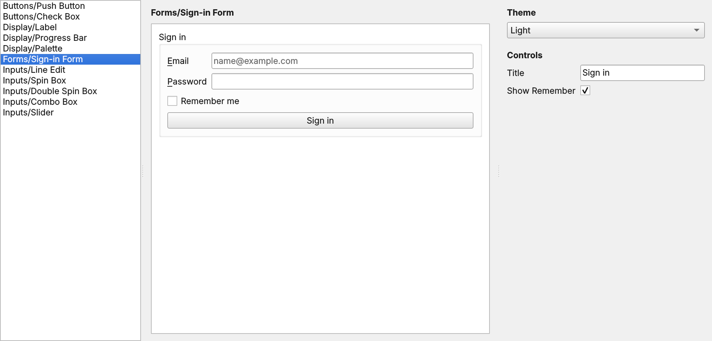

# pyside6-storybook

A small, Storybook-style component explorer for [PySide6](https://doc.qt.io/qtforpython-6/). Write *stories*, functions that build one
widget in one state, and browse them in a gallery window: edit each story's arguments live, switch between light and dark themes, and see
an error in place of a story that breaks instead of a crashed app.



!!! note "Status"
    Early development, not yet released. Until 0.1.0 is published on PyPI, install it from GitHub.
    The [roadmap](roadmap.md) describes what is planned next.

## Install

pyside6-storybook needs Python 3.11 or newer and PySide6 6.8 or newer. Its only dependency is `PySide6-Essentials`, which a
project that already depends on the full `PySide6` package satisfies.

```bash
pip install git+https://github.com/Youth-Research-Center/pyside6-storybook
```

or, as a development dependency of a project managed with [uv](https://docs.astral.sh/uv/):

```bash
uv add --dev git+https://github.com/Youth-Research-Center/pyside6-storybook
```

uv installs it into the project's `.venv` without activating that environment, so with uv, put `uv run` in front of the
`pyside6-storybook` commands in this documentation (or activate `.venv` first).

Then open the built-in example stories:

```bash
pyside6-storybook --examples
```

With uv:

```bash
uv run pyside6-storybook --examples
```

## Your first story

Create `stories/greeting_story.py` in your project:

```python
from PySide6.QtWidgets import QPushButton, QWidget

from pyside6_storybook import BoolControl, StoryContext, TextControl, story


@story(
    "Buttons/Greeting",
    controls=[TextControl("text", "Hello!"), BoolControl("enabled", default=True)],
)
def greeting_button(ctx: StoryContext) -> QWidget:
    """A push button whose text and enabled state can be edited in the gallery."""
    button = QPushButton(ctx.args["text"])
    button.setEnabled(ctx.args["enabled"])
    return button
```

and open it, with `uv run` in front when you installed with uv:

```bash
pyside6-storybook stories
```

- `@story` registers the function under an id. The parts before the last `/` group stories (here `Buttons`); the last part is the
  story's name.
- The gallery calls the function with a `StoryContext`: `ctx.args` holds the current value of each control, by name, and
  `ctx.theme` the name of the active theme. The story is built again from scratch whenever a control or the theme changes.
  `ctx.tokens` holds the theme provider's design tokens (see [Themes](themes.md#design-tokens)).
- The function returns the widget to show. If it raises, or returns something that is not a widget, the gallery shows the error
  and its traceback in place of the widget, and the other stories keep working.
- Discovery picks up every file named `*_story.py` or `*_stories.py` below a folder. Story files can import your application, and
  each other, like any module of your project.

## Where to go next

- [Writing stories](writing-stories.md): `@story`, ids and groups, the `StoryContext`, variants, layout and decorators.
- [Controls](controls.md): every control type and its options.
- [Finding stories](finding-stories.md): targets, file names, `pyproject.toml` and entry points.
- [Command line](command-line.md): every option and the exit codes.
- [The gallery](gallery.md): the window, keyboard, canvas, Docs tab, logging actions and hot reload.
- [Themes](themes.md): the built-in themes, theme providers, design tokens and styling the gallery.
- [Testing stories](testing.md): the pytest plugin, accessibility and contrast checks, snapshots and the `render_story` fixture.
- [Troubleshooting](troubleshooting.md): load errors, duplicate ids, headless runs, fonts in CI.
- [API reference](reference.md): every public name.
- [Changelog](changelog.md): what changed in each release.
- [Roadmap](roadmap.md): the plan and the design decisions.
