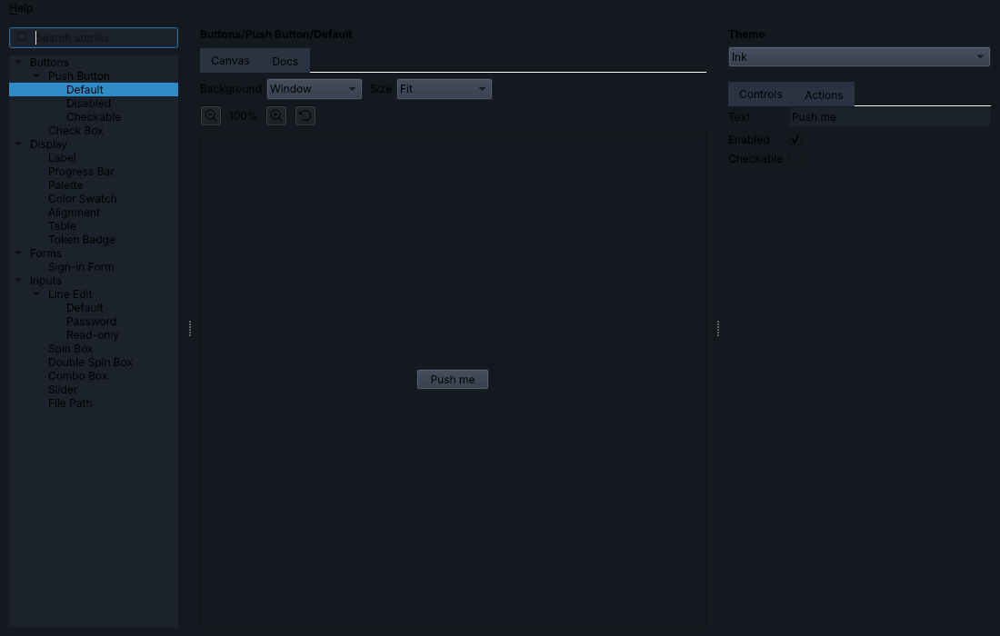
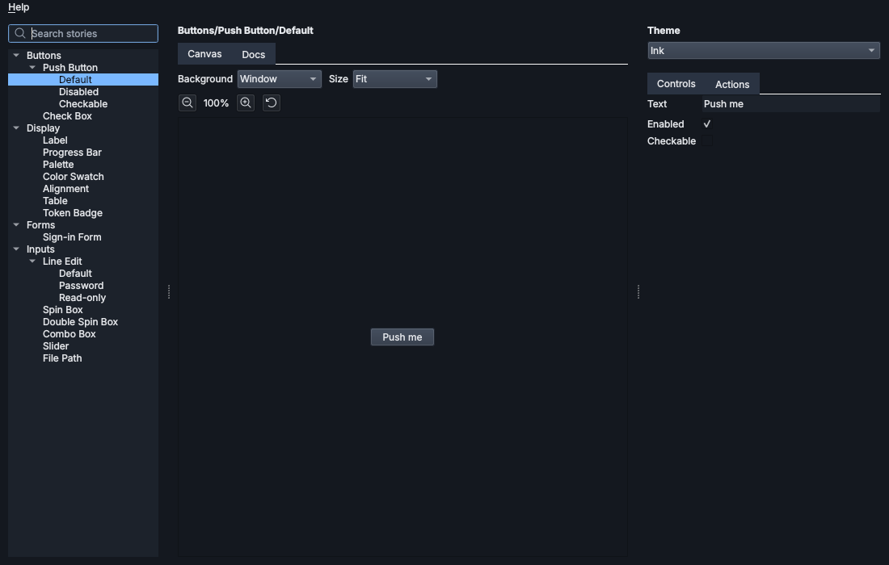

# Themes

pyside6-storybook shows your stories under a theme. It ships three themes, and an application that has its own theme manager can plug it
in with a theme provider, so the gallery shows the stories exactly as the application would. This page explains the built-in themes, when
to write a provider, the provider protocol and its contract, design tokens, the System theme, how to choose a provider, how the gallery's
own widgets behave under an application style sheet, and what to check when something goes wrong. The folder
[`examples/themed_app`](https://github.com/Youth-Research-Center/pyside6-storybook/tree/main/examples/themed_app) is a complete, runnable
example and is walked through at the end.

## The built-in themes

The gallery switches between three built-in themes. Light and Dark are the Fusion style with an explicit palette, so a widget looks
the same on Windows, macOS and Linux. System puts back the style, palette and style sheet your application had when the gallery
started and lets the colour scheme follow the operating system, unless the application had forced one; it follows a change of the
system's scheme while the gallery runs. `Ctrl+T` switches to the next theme: Light, Dark, System, and Light again. Where Qt has no
colour-scheme setting, and on the offscreen platform, System is whatever Qt defaults to.

The built-in themes only set a palette: an application-wide style sheet takes precedence over the palette for the widgets it styles, so
they have no visible effect on those widgets (see [Common problems](#common-problems)).

## When to write a provider

Write a provider when your widgets get their look from something the built-in themes do not touch: an application style sheet, a
theme manager that sets its own palette and fonts, or custom-painted widgets that read colours from your own design tokens. A story
then renders with your real themes, and the theme switch lists their names. If your widgets follow the palette and nothing else, the
built-in themes are enough.

## The theme provider protocol

An application that has its own theme manager plugs it in with a theme provider, an object that implements the `ThemeProvider`
protocol. `BuiltinThemeProvider` is the default one and a model for your own:

<!-- docs-test: skip — opens the gallery and blocks until the window is closed -->
```python
from pyside6_storybook import BuiltinThemeProvider, run

raise SystemExit(run(theme_provider=BuiltinThemeProvider(), theme="Dark"))
```

A provider is any object with these six methods; `ThemeProvider` is a runtime-checkable `typing.Protocol`, so no base class is needed.
The gallery calls every method on the main thread.

| Method | What it does |
| --- | --- |
| `theme_names()` | The names the theme switch lists. Not empty, and it works before `activate`. |
| `current_theme()` | The name of the current theme. Also works before `activate`. |
| `activate(app)` | Called once before the window is built. Record what the provider will change on the `QApplication` and apply the current theme. |
| `set_theme(name)` | Apply a theme. Raise `ValueError` for a name that `theme_names()` does not list. |
| `on_changed(callback)` | Register a callback, called with no arguments after every theme change: one the gallery asked for and one the provider made itself. |
| `deactivate()` | Restore the style, palette, style sheet and font, and clear the callbacks. |

The gallery re-renders the preview when the provider calls its callbacks, so a theme change the provider makes by itself shows up too.

Two optional methods are looked up with `getattr` and are not part of the protocol:

- `tokens() -> Mapping[str, object]`: the design tokens of the current theme (see [Design tokens](#design-tokens)).
- `color_scheme() -> Qt.ColorScheme`: whether the current theme is light or dark (see [The System theme and `ctx.color_scheme`](#the-system-theme-and-ctxcolor_scheme)).

### The contract

- **A style sheet needs a palette.** A provider that sets an application-wide style sheet also sets a matching `QPalette`. The
  gallery's widgets are drawn from palette roles, and a style sheet alone leaves `QApplication.palette()` unchanged.
- **Full teardown, the font included.** `deactivate` restores the style, palette, style sheet and font, and the colour scheme if the
  provider set one. Read the original style while no application style sheet is set: with one, `QApplication.style().name()` is empty.
  `run()` compares these four properties before `activate` and after `deactivate` and logs a warning naming each one the provider did not
  restore; it does not fix them.
- **Main thread only.** Every method is called on the main thread, and callbacks must be called on it too.
- **Notify on every change, including your own.** The gallery re-renders the preview from the notification, not from its own switch.
  A change the provider makes by itself (an application manager that follows the system, a timer) must call the callbacks too. The
  provider may call them synchronously inside `set_theme` or later.
- **Callbacks end with `deactivate`.** It clears them, so none is called again and a provider used by a second `run()` starts with none.
- **A provider can be activated again after `deactivate`.** The pytest plugin (see [Testing stories](testing.md)) activates the
  provider before the first story test, deactivates it when the next test is not a story test, and activates it again for the next
  story test, so `activate` must work on a provider that was deactivated, and a second `activate` must record the application's look
  again.
- **Polish before a style sheet change.** Qt can crash when the application style sheet changes while a widget exists that was never
  polished. Call `ensurePolished()` on `QApplication.allWidgets()` before you set or clear the style sheet, as the example does.

Every call into a provider is guarded: an exception is logged and shown in the preview as "Theme provider failed: ...", and the
gallery keeps running. If `activate` raises, the gallery does not open.

## The System theme and `ctx.color_scheme`

A story reads whether the active theme is light or dark from `ctx.color_scheme`, a `Qt.ColorScheme` (`Qt.ColorScheme.Unknown` when
a context is built by hand). A provider can supply it with an optional `color_scheme()` method; without one the gallery gives
`Dark` when the application palette's `Window` colour has a lightness below 128 and `Light` otherwise. Like `tokens()`, the method
is read after `activate` and after every change notification, and it is not part of the six-method protocol.

System is a built-in theme only. A provider of your own can follow the system by itself and call its callbacks when the scheme changes.

## Choosing a theme provider

An application with its own themes lets the gallery use them through a `ThemeProvider`. There are three ways to choose one, and the
first that applies wins:

1. **Code:** `run(registry, theme_provider=MyProvider())`.
2. **Command line:** `--theme-provider my_app.theming:provider`, and `--theme Ink` for the starting theme.
3. **`pyproject.toml`:** `theme_provider = "my_app.theming:provider"` and `theme = "Ink"` under `[tool.pyside6-storybook]`.

The command line wins over `pyproject.toml`, and without either the gallery uses the built-in Light, Dark and System themes. The
value is `module:attribute`, and the attribute may be dotted (`my_app.theming:Theme.provider`). It is an instance, a class or a
function that takes no arguments and returns a provider; the object must have a callable for each method of `ThemeProvider`. The
module is imported after `pythonpath` and the working directory are on `sys.path`, and before your stories, so a theme manager that
the stories and the provider both import is the same module in both.

The provider and the modules it imports are not reloaded when a story changes, and editing them triggers no reload: restart the
gallery after editing the provider. Import the theme manager at module level in the provider's module: the provider is loaded before
the stories, so everything it imports then is kept. A module it imports only later (in `activate`, `set_theme` or `tokens`) is kept
only if no story imported it first, and otherwise is reloaded with the stories, which would then hold a second copy of the manager.

## Design tokens

A provider can also describe its theme to the stories. If it has a `tokens()` method returning a mapping of names to values, the
gallery reads it after `activate` and after every change notification, and every story receives the result as `ctx.tokens`, a
read-only mapping that is empty when the provider has no `tokens()` (the method is optional and not part of the protocol). A failing
`tokens()` is shown like any provider error, and the stories then see an empty mapping. A story reads tokens like this:

<!-- docs-test: skip — a fragment that uses ctx outside a story function -->
```python
accent = ctx.tokens.get("accent", "#1f5fc4")
```

`BuiltinThemeProvider.tokens()` returns `#rrggbb` strings read from the application palette's Active group, so they are correct for
whichever theme is applied:

| Token | Palette role |
| --- | --- |
| `window` | `Window` |
| `window_text` | `WindowText` |
| `base` | `Base` |
| `alternate_base` | `AlternateBase` |
| `text` | `Text` |
| `button` | `Button` |
| `button_text` | `ButtonText` |
| `highlight` | `Highlight` |
| `highlighted_text` | `HighlightedText` |
| `accent` | `Accent` |
| `border` | `Mid` |
| `placeholder_text` | `PlaceholderText` |

The gallery never calls anything on your widget. A widget that takes tokens gets them from the story, so give it a method such as
`set_tokens` and call it yourself. The story is built again on every theme change, so the widget repaints with the new tokens:

```python
from collections.abc import Mapping

from PySide6.QtGui import QColor, QPalette
from PySide6.QtWidgets import QLabel, QWidget

from pyside6_storybook import StoryContext, story


class TokenBadge(QLabel):
    """A label that paints its background with the accent token."""

    def set_tokens(self, tokens: Mapping[str, object]) -> None:
        palette = self.palette()
        palette.setColor(QPalette.ColorRole.Window, QColor(str(tokens.get("accent", "#1f5fc4"))))
        self.setAutoFillBackground(True)
        self.setPalette(palette)


@story("Display/Token Badge")
def token_badge(ctx: StoryContext) -> QWidget:
    badge = TokenBadge("New")
    badge.set_tokens(ctx.tokens)
    return badge
```

Build `StoryContext` yourself in a test and `tokens` is empty, so let a widget fall back to the matching palette role when a token is
missing. The built-in example `Display/Token Badge` does.

`run(registry, argv, *, theme=None, theme_provider=None)` opens the gallery. `theme` must be one of the provider's names; `run` raises
`ValueError` otherwise. After the provider is deactivated, `run` logs a warning for each of the application's style, palette, style sheet
and font that the provider did not restore.


## Why a provider needs a palette

The two screenshots show why the palette matters. Both use a provider that applies the same dark style sheet. Without a palette the
gallery's text keeps the default dark colours on the dark backgrounds:



With a matching palette the same style sheet gives a readable gallery:



They are rendered by `uv run python scripts/docs/render_theming_images.py`.

## Styling the gallery

The gallery accepts the application's styling, so it looks like the application. It guarantees only that its own text, selection and
focus indicators stay readable. Qt cannot exempt a subtree from an application style sheet, and the gallery does not try: a rule like
`QPushButton { ... }` reaches the gallery's buttons and your story's buttons alike. The gallery adds no style sheet of its own; its
colours come from palette roles, which is why a provider that sets a style sheet also sets a matching palette (see [Themes](#the-built-in-themes)).

Two things make the gallery's widgets addressable without touching your stories:
- **Object names.** Every widget of the gallery has an object name with the prefix `sbk`, so `#sbkStoryTree` selects the story tree.
  `#sbkName` is the strongest selector an application can use.
- **The `sbkChrome` property.** Widgets that you may want to style and that contain no story widget have the property `sbkChrome`
  set to `true`: the sidebar, the canvas controls, the tab bars, the side pane and everything in it, the Docs panel, the status bar,
  the error panel and the empty-state labels. The widgets that hold the preview (the window, the splitter, the preview pane, the
  preview tab widget, the canvas, the scroll area and its viewport, the stack and the surface) have a name only, so
  `*[sbkChrome="true"] QPushButton` reaches the gallery's buttons and never a story's.

```css
/* The gallery's controls only. */
*[sbkChrome="true"] { font-size: 11pt; }
*[sbkChrome="true"] QPushButton { padding: 2px 8px; }
QPushButton[sbkChrome="true"] { border-radius: 4px; }
#sbkStoryTree::item:selected { background: #1e88e5; }
```

**Specificity.** `QPushButton[sbkChrome="true"]` beats `QPushButton` and `QWidget QPushButton` wherever they appear. It has the same
specificity as `QPushButton[flat="false"]` and `QPushButton:hover`, so between those the rule that comes later in the style sheet
wins. `#sbkName` (an ID) beats all of them in any order. Put the chrome rules after your general rules, restate the pseudo-states
(`:hover`, `::tab:selected`) that your general rules use, and use `#sbkName` for a single widget.

**The selected story.** A rule can colour the selected row with `selection-background-color` or with
`QTreeView::item:selected { background: ... }`. The sidebar reads the colour the style really draws behind the row and paints the
row's text in a colour that is readable on it. When your rule also sets `color` for selected items, the style sheet wins and the
gallery's colour is ignored.

The object names:

- `sbkStorySidebar`: the sidebar, with `sbkStorySearch`, `sbkStoryTree` and `sbkStorySearchEmptyState`.
- `sbkCanvas`: the canvas (a name only), with `sbkCanvasToolbar`, `sbkCanvasBackground`, `sbkCanvasSize`, `sbkCanvasSizeLabel`,
  `sbkCanvasWidth`, `sbkCanvasHeight`, `sbkCanvasZoomOut`, `sbkCanvasZoomLevel`, `sbkCanvasZoomIn`, `sbkCanvasZoomReset` and
  `sbkCanvasZoomNote`.
- `sbkPreviewScroll`, `sbkPreviewStack`, `sbkPreviewSurface`, `sbkPreviewTabs` and `sbkPreviewZoomImage`: the widgets that hold the
  preview (names only).
- `sbkPreviewHeading`, `sbkPreviewEmptyState` and `sbkPreviewError`: the heading above the preview, its empty-state label and the error
  panel, with `sbkErrorIcon`, `sbkErrorTitle` and `sbkErrorDetails`.
- `sbkThemeSwitch`, `sbkSideTabs` (a name only), `sbkControlsScroll` and `sbkControlsEmptyState`: the side pane.
- `sbkActionsPanel`, `sbkActionsTree`, `sbkActionsStatus` and `sbkActionsClear`: the Actions tab.
- `sbkDocsScroll`, `sbkDocsPanel`, `sbkDocsContent`, `sbkDocsHeading`, `sbkDocsModuleDoc`, `sbkDocsStoryDoc`, `sbkDocsNoControls`,
  `sbkDocsVariantCaption`, `sbkDocsControlsTable`, `sbkDocsSiblingCurrent`, `sbkDocsSiblingLink`, `sbkDocsNoSource`,
  `sbkDocsCopyButton` and `sbkDocsSource`: the Docs tab.
- `sbkReloadStatus` and `sbkReloadStatusIcon`: the status bar.
- `sbkShortcutsDialog` and `sbkShortcutsTable`: the Keyboard shortcuts dialog.

## Common problems

- **The switch does nothing.** Your application sets a style sheet, which overrides the palettes of the built-in themes for the widgets
  it styles. Use a provider that applies your own themes.
- **The chrome is unreadable.** The provider sets a style sheet but no palette, as in the first screenshot. Set a matching `QPalette`.
- **The font stays changed after closing the gallery.** Your `deactivate` does not restore the font. Record `app.font()` in
  `activate` and set it back; `run()` logs a warning naming the property.
- **A change of the provider does not re-render the preview.** The provider never calls the `on_changed` callbacks for it. Call them
  after every change, including one the provider makes itself.

## Worked example: `examples/themed_app`

[`examples/themed_app`](https://github.com/Youth-Research-Center/pyside6-storybook/tree/main/examples/themed_app) is a small application
with two themes, Paper (light) and Ink (dark). It is not part of
the wheel. Its files:

- `themed_app/theme_manager.py`: `ThemeManager`, a `QObject` with a `themeChanged` signal. Each theme is a style sheet, a full
  `QPalette` and a token dict. `apply(app, name)` polishes every widget, then sets palette, style sheet and font.
- `themed_app/widgets.py`: `PillButton`, styled by the style sheet through its object name, and `Gauge`, painted from tokens with
  `set_tokens`.
- `themed_app/stories/`: the stories. The gauge story passes `ctx.tokens` to `set_tokens`.
- `themed_app/storybook.py`: `ThemedAppProvider`, which adapts the manager to the protocol, and `provider`, a function that returns
  one. It imports the manager at module level, records and restores style, palette, style sheet and font, and calls its callbacks
  whenever the manager's `themeChanged` fires.
- `pyproject.toml`: only `[tool.pyside6-storybook]` with `stories`, `pythonpath = ["."]` and
  `theme_provider = "themed_app.storybook:provider"`.

Run it from its folder:

```bash
cd examples/themed_app
uv run --project ../.. pyside6-storybook
```

The folder has no `[project]` table of its own, so a plain `uv run` there would create a separate environment without
pyside6-storybook. `--project ../..` uses the repository's environment while the working directory, and so the example's
`pyproject.toml`, stays the example's. Add `--list` to print the stories and the provider without opening a window.
