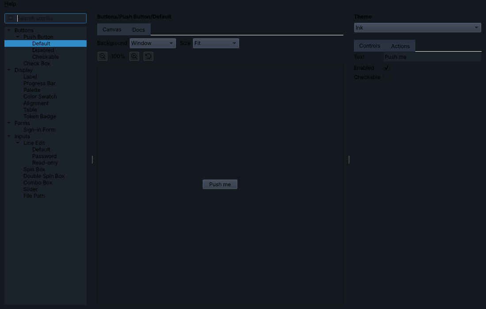
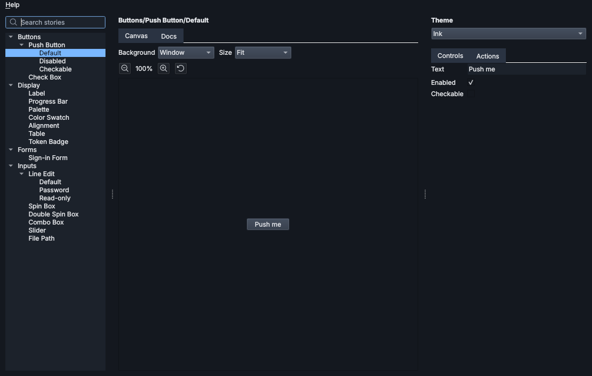

# Theming guide

pyside6-storybook shows your stories under a theme. It ships three themes, and an application that has its own theme manager can plug
it in with a theme provider, so the gallery shows the stories exactly as the application would. This guide explains the built-in
themes, when to write a provider, the provider protocol and its contract, design tokens, the System theme, how to choose a provider,
how the gallery's own widgets behave under an application style sheet, and what to check when something goes wrong. The folder
[`examples/themed_app`](https://github.com/Youth-Research-Center/pyside6-storybook/tree/main/examples/themed_app) is a complete, runnable
example and is walked through at the end.

## The built-in themes

`BuiltinThemeProvider` is the default provider and offers three themes:

- **Light** and **Dark**: the Fusion style with an explicit palette, so a widget looks the same on Windows, macOS and Linux.
- **System**: puts back the style, palette and style sheet your application had when the gallery started and lets the colour scheme
  follow the operating system, unless the application forced one. It follows a change of the system's scheme while the gallery runs.
  On the offscreen platform and where Qt has no colour-scheme setting, System is whatever Qt defaults to.

`Ctrl+T` switches to the next theme. The built-in themes only set a palette: an application-wide style sheet takes precedence over
the palette for the widgets it styles, so they have no visible effect on those widgets (see the troubleshooting section).

## When to write a provider

Write a provider when your widgets get their look from something the built-in themes do not touch: an application style sheet, a
theme manager that sets its own palette and fonts, or custom-painted widgets that read colours from your own design tokens. A story
then renders with your real themes, and the theme switch lists their names. If your widgets follow the palette and nothing else, the
built-in themes are enough.

## The protocol

A provider is any object with these six methods; `ThemeProvider` is a runtime-checkable `typing.Protocol`, so no base class is needed.
The gallery calls every method on the main thread.

- `theme_names()`: the names the theme switch lists. Not empty, constant while the provider is active, and available before
  `activate`, so `--theme` can be validated and `--list` can print them.
- `current_theme()`: the name of the current theme. Also available before `activate`.
- `activate(app)`: called once, before the window is built. Record whatever you will change (style, palette, style sheet, font,
  colour scheme) and apply the current theme. An application builds its theme manager here or earlier.
- `set_theme(name)`: apply a theme. Raise `ValueError` for a name that `theme_names()` does not list. The gallery only calls it with
  listed names.
- `on_changed(callback)`: register a callback, called with no arguments after every theme change. Several callbacks may be
  registered and are called in order.
- `deactivate()`: undo everything `activate` and `set_theme` changed, and clear the registered callbacks.

Two optional methods are looked up with `getattr` and are not part of the protocol:

- `tokens() -> Mapping[str, object]`: the design tokens of the current theme (see below).
- `color_scheme() -> Qt.ColorScheme`: whether the current theme is light or dark (see the System theme).

### The contract

- **A style sheet needs a palette.** A provider that sets an application-wide style sheet also sets a matching `QPalette`. The
  gallery's widgets are drawn from palette roles, and a style sheet alone leaves `QApplication.palette()` unchanged.
- **Full teardown, the font included.** `deactivate` restores the style, palette, style sheet and font, and the colour scheme if the
  provider set one. Read the original style while no application style sheet is set: with one, `QApplication.style().name()` is empty.
  `run()` compares these four properties before `activate` and after `deactivate` and logs a warning naming each one the provider did not
  restore; it does not fix them.
- **Main thread only.** Every method is called on the main thread, and callbacks must be called on it too.
- **Notify on every change, including your own.** The gallery re-renders the preview from the notification, not from its own switch.
  A change the provider makes by itself (an application manager that follows the system, a timer) must call the callbacks too. The
  provider may call them synchronously inside `set_theme` or later.
- **Callbacks end with `deactivate`.** It clears them, so none is called again and a provider used by a second `run()` starts with none.
- **A provider can be activated again after `deactivate`.** The pytest plugin (see "Testing stories" in the README) activates the
  provider before the first story test, deactivates it when the next test is not a story test, and activates it again for the next
  story test, so `activate` must work on a provider that was deactivated, and a second `activate` must record the application's look
  again.
- **Polish before a style sheet change.** Qt can crash when the application style sheet changes while a widget exists that was never
  polished. Call `ensurePolished()` on `QApplication.allWidgets()` before you set or clear the style sheet, as the example does.

Every call into a provider is guarded: an exception is logged and shown in the preview as "Theme provider failed: ...", and the
gallery keeps running. If `activate` raises, the gallery does not open.

## Design tokens in stories

A custom-painted widget cannot read its colours from a style sheet. A provider with a `tokens()` method gives the gallery a mapping of
names to values (for example `accent`, `surface`, `text`, `track` as `#rrggbb`). The gallery reads it after `activate` and after every
change notification, and every story receives it as `ctx.tokens`, a read-only mapping that is empty without a `tokens()` method.

The gallery never calls anything on your widget. Give the widget a `set_tokens` method and call it from the story; the story is built
again on every theme change, so the widget repaints with the new tokens:

```python
@story("Meters/Gauge", controls=[IntControl("value", 65, 0, 100)])
def gauge(ctx: StoryContext) -> QWidget:
    widget = Gauge()
    widget.set_tokens(ctx.tokens)
    widget.value = ctx.args["value"]
    return widget
```

Let the widget fall back to a palette role for a token that is missing, because a `StoryContext` built by hand has none.
`BuiltinThemeProvider.tokens()` returns twelve colours read from the palette; the README lists them.

## The System theme and `ctx.color_scheme`

System is a built-in theme only. A provider of your own can follow the system by itself and call its callbacks when the scheme
changes. `ctx.color_scheme` is a `Qt.ColorScheme`: a story reads it to tell a light theme from a dark one. A provider supplies it with
`color_scheme()`; without that method the gallery guesses `Dark` when the application palette's `Window` colour has a lightness below
128 and `Light` otherwise. It is `Unknown` only in a context built by hand.

## Choosing a provider

There are three ways, and the first that applies wins:

1. **Code:** `run(registry, theme_provider=MyProvider(), theme="Ink")`.
2. **Command line:** `--theme-provider my_app.theming:provider` and `--theme Ink`.
3. **`pyproject.toml`:** `theme_provider = "my_app.theming:provider"` and `theme = "Ink"` under `[tool.pyside6-storybook]`.

Without any of them the built-in themes are used. The value is `module:attribute` (dotted attributes are allowed) and names an
instance, a class or a no-argument function that returns a provider; the result must have a callable for each protocol method.
A provider that cannot be loaded, or an unknown theme, prints an error and exits with code 1: the built-in themes are never used
instead. The module is imported after `pythonpath` and the working directory are on `sys.path`, and before your stories.

The provider and the modules it imports are not reloaded when a story changes, and editing them triggers no reload: restart the
gallery after editing the provider. Import the theme manager at module level in the provider's module. The provider is loaded before
the stories, so everything it imports then is kept, and the stories and the provider share one theme manager. A module the provider
imports only later is kept only if no story imported it first; otherwise it is reloaded with the stories, which then hold a second copy.

## The gallery's widgets under an application style sheet

The gallery accepts the application's styling, so it looks like the application. It guarantees only that its own text, selection and
focus indicators stay readable. Qt cannot exempt a subtree from an application style sheet, and the gallery does not try: a rule like
`QPushButton { ... }` reaches the gallery's buttons and your story's buttons alike. The gallery adds no style sheet of its own.

Every widget of the gallery has an object name with the prefix `sbk`, and widgets you may want to style carry the property
`sbkChrome="true"`; the widgets that hold the preview do not, so `*[sbkChrome="true"] QPushButton` never reaches a story's buttons.
The README's section [Styling the
gallery](https://github.com/Youth-Research-Center/pyside6-storybook/blob/main/README.md#styling-the-gallery) lists every name.

```css
*[sbkChrome="true"] QPushButton { padding: 2px 8px; }
#sbkStoryTree::item:selected { background: #1e88e5; }
```

**Specificity.** `QPushButton[sbkChrome="true"]` beats `QPushButton` and `QWidget QPushButton` wherever they appear. It has the same
specificity as `QPushButton[flat="false"]` and `QPushButton:hover`, so between those the rule that comes later in the style sheet
wins. `#sbkName` beats all of them in any order. Put the chrome rules after your general rules, restate the pseudo-states (`:hover`,
`::tab:selected`) that your general rules use, and use `#sbkName` for a single widget. A rule that sets `color` for selected items
wins over the colour the sidebar picks for the selected story.

The two screenshots show why the palette matters. Both use a provider that applies the same dark style sheet. Without a palette the
gallery's text keeps the default dark colours on the dark backgrounds:



With a matching palette the same style sheet gives a readable gallery:



They are rendered by `uv run python scripts/docs/render_theming_images.py`.

## Troubleshooting

- **The switch does nothing.** Your application sets a style sheet, which overrides the palettes of the built-in themes for the widgets
  it styles. Use a provider that applies your own themes.
- **The chrome is unreadable.** The provider sets a style sheet but no palette, as in the first screenshot. Set a matching `QPalette`.
- **The font stays changed after closing the gallery.** Your `deactivate` does not restore the font. Record `app.font()` in
  `activate` and set it back; `run()` logs a warning naming the property.
- **A change of the provider does not re-render the preview.** The provider never calls the `on_changed` callbacks for it. Call them
  after every change, including one the provider makes itself.

## Worked example: `examples/themed_app`

[`examples/themed_app`](https://github.com/Youth-Research-Center/pyside6-storybook/tree/main/examples/themed_app) is a small application
with two themes, Paper (light) and Ink (dark). It is not part of
the wheel. Its files:

- `themed_app/theme_manager.py`: `ThemeManager`, a `QObject` with a `themeChanged` signal. Each theme is a style sheet, a full
  `QPalette` and a token dict. `apply(app, name)` polishes every widget, then sets palette, style sheet and font.
- `themed_app/widgets.py`: `PillButton`, styled by the style sheet through its object name, and `Gauge`, painted from tokens with
  `set_tokens`.
- `themed_app/stories/`: the stories. The gauge story passes `ctx.tokens` to `set_tokens`.
- `themed_app/storybook.py`: `ThemedAppProvider`, which adapts the manager to the protocol, and `provider`, a function that returns
  one. It imports the manager at module level, records and restores style, palette, style sheet and font, and calls its callbacks
  whenever the manager's `themeChanged` fires.
- `pyproject.toml`: only `[tool.pyside6-storybook]` with `stories`, `pythonpath = ["."]` and
  `theme_provider = "themed_app.storybook:provider"`.

Run it from its folder:

```bash
cd examples/themed_app
uv run --project ../.. pyside6-storybook
```

The folder has no `[project]` table of its own, so a plain `uv run` there would create a separate environment without
pyside6-storybook. `--project ../..` uses the repository's environment while the working directory, and so the example's
`pyproject.toml`, stays the example's. Add `--list` to print the stories and the provider without opening a window.
